# Add bottle: one page, label then bottle

Status: design record, in progress. Mockups only; nothing is built and the design is not yet approved for a build plan. Written 2026-11-23 from a long design conversation with the owner. Open questions are listed in section 12. Photos are section 11.

The clickable mockups are in [`2026-11-23-add-bottle-redesign/`](2026-11-23-add-bottle-redesign/). Open `form-by-category.html` in a browser, pick any subcategory, and the form redraws with the fields this record allows. Screenshots are embedded below so they read on GitHub.

## 1. Intent

The Collection page's "Add bottle" button leads to a long form. The owner mostly adds **bottles whose label is not in the app yet**, so the path that creates a label and a bottle in one go is the main one. Today it feels unintuitive for these reasons:

- The form shows the database model (label, vintage, "this bottle's own proof, age and size") instead of the task.
- On a new label, the bottle's override block (about 11 fields) repeats what was typed a moment earlier.
- There are two photo areas (a label photo and "Bottle photos").
- Optional facts are given equal weight with the one required field, and unset selects read "Unknown".
- The TTB approval search is visually loud.
- A first chip-based mockup lost things that matter: stated, inferred and undisclosed distilleries, each distillery's share, separate mashbill and finish.

**The top priority is less scrolling and a form that is easy to fill out.**

## 2. Goals, non-goals, anti-goals

Goals:

- One page: **1 The label**, **2 The bottle in your hand**, one save ("Save label and bottle").
- Each spirit shows only the fields that apply to it (section 7 and 8).
- Nothing the owner can already record is lost: stated / inferred / not disclosed, shares, mashbill and finish as separate things, mashbill and distillery suggesting each other.
- Values that can be worked out are worked out (an age sets the class or designation, and so on).

Non-goals (separate work, see section 13): a wizard or stepper, an accordion (parked for the bottle and label display pages), the popups for adding a distillery, finish or mashbill, the Configuration page, the Labels page.

Anti-goals: hiding data the user has entered, "Unknown" as a default value, a loud TTB call to action, rounded-card soup (see DESIGN.md).

## 3. The layout: "the data sheet"

Chosen over a wizard, an accordion with a live bottle card, and a "printed on the bottle vs what you know" split. See [`screenshots/00-data-sheet-layout.png`](2026-11-23-add-bottle-redesign/screenshots/00-data-sheet-layout.png).

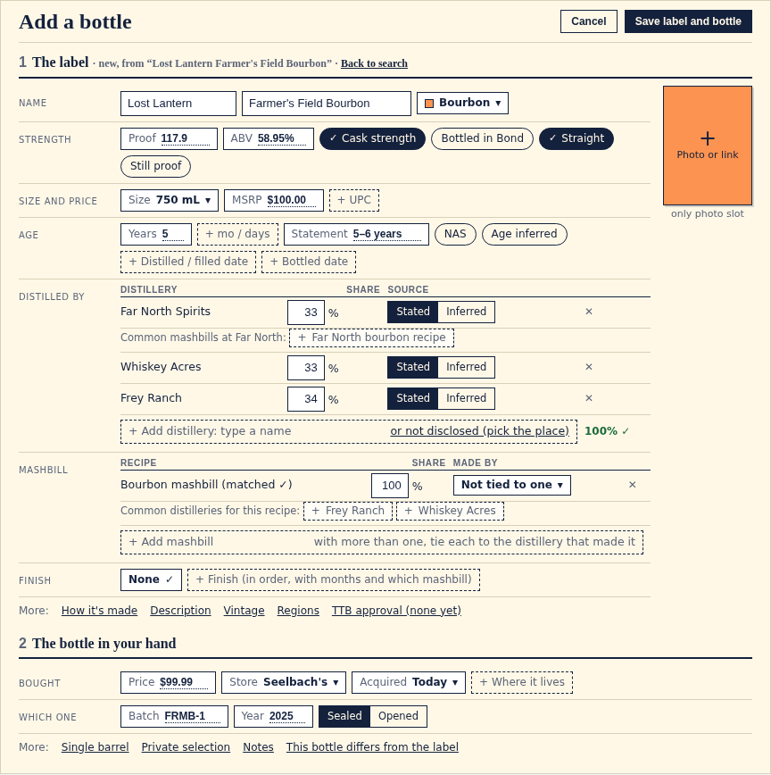

- Rows with a small-caps label on the left. Drawn at **864px wide** (a half-screen on a laptop), which is the width to design for.
- Short facts are chips with an inline input (type straight into Proof, ABV, MSRP, Price). Choices open a popover. Unset optional things are **dashed "+" chips**, never "Unknown".
- Anything with several entries (distilleries, mashbills, grapes, fruit) is a small table with a Share column.
- Rare things live on a **More:** line of links, on the label and on the bottle.
- **Save** is pinned at the top right. A "Save and add another" button was floated but is not decided.
- One photo slot, on the label, framed in the category colour (DESIGN.md section 4). How a photo gets in, and how photos are shared between a label, its vintages and its bottles, is section 11.

## 4. Decisions that apply to every spirit

Strength and age:

- **Strength row:** Proof, ABV, then the designations that apply (Cask strength, Bottled in Bond, Straight). There is no separate "Flags" group.
- **Age row:** the Aged toggle where it exists, class or designation selects, years / months / days, Age statement, NAS, and dashed "+" boxes for Distilled / filled date and Bottled date. "Age inferred" marks an age that is known but not printed.
- **Size and price row:** Size, MSRP, + UPC.

Where it came from:

- **Distilled by** is a table: Distillery, Share, Source (Stated / Inferred). "Not disclosed (pick the place)" lives inside the add-distillery row, not as a separate checkbox.
- **Mashbill** and **Finish** are separate rows. Mashbills and distilleries suggest each other both ways, and "Made by" ties a recipe to a distillery (this already exists in the form: "Common mashbills" under a distillery and "Common distilleries" under a mashbill). Finish carries months and which mashbill, as it does today (see the 2026-11-08 finish and mashbill pairing spec).
- Grapes (Cognac, Armagnac, Pisco) and Calvados fruit are entered **like a mashbill**: a table of name and share.
- Fixed values show as a plain tinted chip with no "(fixed)" wording (Blue Weber, Sugarcane juice, Juniper, 100% malted barley, Apple).

More lines:

- **Label More:** Still, Description, Vintage, TTB approval. Plus Flavor for mezcal, and Dairy for every liqueur except cream.
- **Bottle More:** Single barrel (the word is "cask" for non-American whiskey and "lot" for agave), Private selection, Warehouse / rick, Notes, "This bottle differs from the label".

TTB approval is **one grey link** under More. It opens a Contractbook-style dialog: search by name or by TTB ID, preview the match, one click fills approval date, name, class and permit number. Pasting an ID from the real registry must fill those the same way (today it does not).

The bottle section:

- **Bought:** Price, Store, Acquired (with a Today button), + Where it lives.
- **Which one:** Vintage choice (only when the label has vintages), Batch (Lot # for agave), Year, Sealed / Opened. Sealed / Opened replaces the status dropdown, the fill dial and the Opened checkbox at add time.
- The bottle's own proof, age and size block is **hidden on a new label** (the bottle inherits). "This bottle differs from the label" opens it.

Still type (new, every spirit): an optional **Still** link under More with the options **Pot, Column, Coffey (a kind of column still), 3-chamber**. The old "blend" value is dropped. Where a rule fixes the still, it stays visible as a locked chip instead (Pays d'Auge is pot, Domfrontais is column, Rhum Agricole with a Martinique distillery pre-selects column).

Barrel type: tequila, mezcal and aged gin show an optional **Barrel type** chip in Age. It is the **Finish data renamed on the page**, with the same options, and the Finish row is hidden for those spirits. Corn Whiskey and Light Whiskey get a Barrel type with the options **Uncharred** and **Used**.

Derived values, never typed twice:

- Age sets the class or designation (tequila, mezcal, Cognac, Armagnac, Calvados). Minimum ages are **floors**: nothing is prefilled, and the age you type drives the class.
- ABV sets the Chilean pisco class. Two or more Peruvian grapes name an Acholado.
- A linked distillery in Martinique on a Rhum Agricole pre-selects Column still.

Retired from every form: **Still proof, Chill filtered, Colour added, Char level, Bottle count**, Country and Region on amaro and liqueur (the distillery supplies it), the VS / VSOP / XO designation on the bottle (the label keeps it), and Barrel-Aged Gin and Aperitif as categories (the Aged toggle and the amaro style cover them).

## 5. Target category tree

The owner confirmed this is a **target** to migrate to, not the current tree. Amaro stays its own field group.

**Status (2026-11-24): built** in PRs #408 and #409 (migration `0055_category_tree.sql`, seed from `src/lib/categories/tree.ts`). Every existing category keeps its id and slug, so no label moved. Decisions taken: the Whiskey umbrella goes (its row, id kept, is renamed **Whisky** and holds Canadian, Japanese, Other International and Flavored); names stay as they are (Wheat Whiskey, Corn Whiskey, Light Whiskey); Amaro stays a top category with no children; the new rows use slugs equal to their kinds (`tennessee`, `japanese`, `international`, `flavored-whisky`, `cachaca`, `agricole`, `spiced-rum`, `apple`, `eau-de-vie`, `absinthe`, `akvavit`, `shochu`) under a new top `other`. The field matrix of sections 7 and 8 is data in `src/lib/expressions/field-matrix.ts`, and `field-matrix-gaps.ts` lists the 32 places today's rules differ from it (PR #410).

| Top category | Subcategories | Field group |
|---|---|---|
| Agave | Tequila, Mezcal | agave |
| American Whiskey | Bourbon, Rye, American Single Malt, Corn, Wheat, Light, **Tennessee** (new; copies bourbon exactly) | whiskey |
| Irish Whiskey | Pot Still, Malt, Grain, Blended | whiskey |
| Scotch | Single Malt, Single Grain, Blended, Blended Grain, Blended Malt | whiskey |
| Whisky | Canadian, Japanese, Other International, **Flavored** (new; uses vodka's Flavors list) | whiskey |
| Vodka | Flavored Vodka | vodka |
| Gin | Genever | gin |
| Rum | **Cachaça**, **Rhum Agricole**, **Flavored / Spiced Rum** (all new) | rum |
| Brandy | Cognac, Armagnac, Calvados, Pisco, **Apple**, **Eau de Vie** (new) | brandy |
| Liqueur | Fruit, Anise, Cream, Nut, Herbal, Chocolate, Coffee | liqueur |
| Other | **Absinthe**, **Akvavit**, **Shochu** (new) | other |
| Amaro | Amaro (Aperitif is a **style**, not a subcategory) | amaro |

Colours: DESIGN.md has 16 category colours keyed to the old tree. The owner will redo colours later; the mockups use placeholders.

## 6. Which rules need a "kind"

A kind is the rule set the code derives from a category's slug (`rules.ts`). Japanese, Other International and the new subcategories fall into a generic "other" today. They need their own kinds so rules can key on them: `japanese`, `international`, `flavored-whisky`, `cachaca`, `agricole`, `spiced-rum`, `apple`, `eau-de-vie`, `absinthe`, `akvavit`, `shochu`. Peat for American Single Malt, Japanese and International is keyed to the subcategory, not just the group. Calvados appellations and mezcal production and class are **selectors on the form**, not subcategories.

## 7. Field matrix (label)

● always, ◐ under a condition, — not shown. Groups follow the field groups in `schema.ts`.

| Field | Whiskey | Rum | Agave | Brandy | Gin | Vodka | Amaro | Liqueur | Other |
|---|---|---|---|---|---|---|---|---|---|
| Brand, Name, Category, MSRP, Size, UPC, Description | ● | ● | ● | ● | ● | ● | ● | ● | ● |
| Proof, ABV | ● | ● | ● | ● | ● | ● | ● | ● | ● |
| Cask strength | ● | ◐ aged | — | ● | — | — | — | — | ● |
| Bottled in Bond, Straight | ◐ American | — | — | — | — | — | — | — | — |
| Navy / overproof badge (worked out from proof) | — | ● | — | — | ● | — | — | — | — |
| Aged toggle | — | ● | — | — | ● | — | ● | ● | — |
| Age years, months | ● | ◐ aged, not solera | ◐ class fields | ● | ◐ aged | — | ◐ aged | ◐ aged | ● |
| Age days | ● | ◐ | ◐ | ● | ◐ | — | — | — | ● |
| Age statement | ● | ◐ | ◐ mezcal only | ● | — | — | ◐ | ◐ | ● |
| NAS | ● | ◐ | — | ◐ not Cognac, Armagnac, Calvados | ◐ aged | — | ◐ | ◐ | ● |
| Distilled / filled date, Bottled date | ● | ◐ not solera | — | ● | — | — | — | — | ● |
| Solera, low and high age in years | — | ◐ aged | — | — | — | — | — | — | — |
| Barrel type | ◐ Corn, Light | — | ● (not Madurado en Vidrio) | — | ◐ aged | — | — | — | — |
| Non-chill filtered | ● | — | — | — | — | — | — | — | — |
| Additive free | ◐ not American, not Scotch | — | ◐ optional | — | — | — | — | — | — |
| Entry proof | ◐ not Scotch | — | — | — | — | — | — | — | — |
| Peat (optional) | ◐ Irish, Scotch, American Single Malt, Japanese, Intl | — | — | — | — | — | — | — | — |
| Cooperage | ● every whiskey | — | — | — | — | — | — | — | — |
| Regions | ◐ Scotch | — | — | — | — | — | — | — | — |
| Distilleries (share, stated / inferred, not disclosed) | ● | ● | ● | ● | ● | ● | ● | ● | ● |
| Mashbill | ● (single malts fixed) | — | — | — | — | — | — | — | — |
| Ingredients | — | base | maguey | grapes / fruit table | botanicals + base | base | botanicals | base | botanicals or base |
| Flavors list | ◐ Flavored | ◐ Spiced | — | — | — | ◐ Flavored | — | ● | — |
| Finish | ● | ◐ aged | — (Barrel type) | ● | — (Barrel type) | — | ◐ aged | ◐ aged | ● |
| Still (optional, under More) | ● | ● | ● | ● | ● | ● | ● | ● | ● |

## 8. Field matrix (bottle)

| Field | Whiskey | Rum | Agave | Brandy | Gin | Vodka | Amaro | Liqueur | Other |
|---|---|---|---|---|---|---|---|---|---|
| Price, Store, Acquired, Where it lives, Notes, Sealed / Opened, Label version | ● | ● | ● | ● | ● | ● | ● | ● | ● |
| Vintage choice (when the label has any) | ● | ● | ◐ mezcal only | ● | — | — | — | — | ● |
| Batch (Lot # for agave), Release year | ● | ● | ● | ● | ● | — | — | — | ● |
| Single barrel, Private selection | ● | ◐ label aged | ● | ● | ◐ label aged | — | — | — | ● |
| Pick name, Picked by, Barrel number | ● | ◐ | ● | ● | ◐ | — | — | — | ● |
| Warehouse, Rick / floor | ◐ American, Japanese, Intl, Flavored | — | — | — | — | — | — | — | — |
| Size override | ● | ● | ● | ● | ● | ● | ● | ● | ● |
| Proof override | ● | ● | ● | ● | ● | ● | — | — | ● |
| Distilled / filled date, Bottled date | ● | ◐ label aged | — | ● | — | — | — | — | ● |
| Age (years, months, days), Age statement | ● | ◐ label aged | ◐ | ● | ◐ label aged | — | — | — | ● |
| Tequila class, Gin NAS | — | — | ◐ | — | ◐ | — | — | — | — |

Bottle rules for rum and gin **follow the label's Aged toggle**. Bottle count is gone.

## 9. Rules by category

**Tequila.** Class: Blanco, Joven, Reposado, Añejo, Extra Añejo, Cristalino (shown in readable words). Blanco and Reposado take only months and days (legally they cannot be a year old); the others take years too. Typing an age sets the class: under 2 months Blanco, 2 months to under a year Reposado, a year or more Añejo, 3 years or more Extra Añejo. Joven and Cristalino stay manual. Maguey row shows Blue Weber. Barrel type replaces Finish. Optional Cooking method, Extraction, Additive free.

**Mezcal.** Same age-to-class rule without Extra Añejo. Class: Blanco / Joven, Reposado, Añejo, Madurado en Vidrio (no barrel, no age typed). Maguey is a free list. **Production** (Mezcal, Artesanal, Ancestral) sits right after Maguey and restricts cooking, extraction and still: Ancestral pre-selects pit-oven cooking and a clay pot still and limits extraction to hand methods; Artesanal rules out the column still and the diffuser; plain Mezcal allows everything (*these follow the designer's reading of the mezcal standard and must be verified*). **Flavor** (Abocado con, Destilado con, with an ingredient list) is optional and opens from More.

**American whiskey.** Straight and Bottled in Bond apply to all seven subcategories, including Tennessee (which copies bourbon exactly, with the charcoal filtering assumed). Bottled in Bond sets proof to 100 and must restore the typed proof when unticked. American Single Malt gets Peat and a fixed 100% malted barley mashbill. Corn and Light Whiskey get Barrel type (Uncharred, Used).

**Scotch.** Regions, Peat and Cooperage. No Entry proof, no Additive free. Single Malt and **Blended Malt** have the fixed 100% malted barley mashbill.

**Irish, Canadian, Japanese, International, Flavored whisky.** Peat for Irish, Japanese and International. Additive free and Entry proof apply (not to Scotch or American). Canadian restricts distilleries to Canada, Irish to Ireland and the UK. Flavored whisky uses vodka's Flavors list. *These have not been reviewed in detail yet.*

**Gin.** Aged toggle. When Aged: Age years and months (no statement), NAS, Barrel type (replaces Finish), and single-barrel and pick links on the bottle. Botanicals lists **Juniper first**, then what is added, then "+ Botanical". Style (optional, not for Genever).

**Genever.** Class: Jonge, Oude, Korenwijn.

**Rum.** Aged toggle (new). Aged shows years, dates, finishes and cask strength, and the bottle follows. **Solera** (only when Aged) takes a **low and a high age measured in years** (for example 5 to 12 years): no single age, no months or days, no distilled / filled date, and the age statement stays. Still type, Marque, Esters, Added sugar. **Rhum Agricole:** base fixed as sugarcane juice, no Added sugar, and a linked Martinique distillery pre-selects Column still. **Cachaça:** base fixed as sugarcane juice, Added sugar kept. **Spiced:** Flavors list and Added sugar.

**Cognac.** Designation VS (2+ years), VSOP (4+), XO (10+), filled in from the age (and from the statement text). No NAS. Grapes table: main grapes Ugni Blanc, Folle Blanche, Colombard; a secondary grape may be any of those or Montils, Folignan, Sémillon, Jurançon Blanc, Meslier St-François, Sélect.

**Armagnac.** Designation from the age: Blanche (unaged), VS / Three-Star, VSOP, Napoléon, XO, Hors d'Âge, Vintage / Millésimé (with a Vintage year). Minimums used: 1, 4, 6, 10, 10 (*designer's recollection of the official ones; verify*). No NAS. Grapes table: major Ugni Blanc, Baco 22A, Folle Blanche, Colombard; minor Clairette de Gascogne, Plant de Graisse, Meslier Saint-François, Jurançon Blanc, Blanquette de Saint-Gaudens, Mauzac.

**Calvados.** Appellation selector: AOC Calvados, Pays d'Auge, Domfrontais. Fruit is a table with a share for each apple type (Bittersweet, Bitter, Sweet, Acidic / tart) and for Pears, with an Apples subtotal and a Total. Designation from the age: Fine (2+), Vieux / Réserve (3+), VSOP / VO / Vieille Réserve (4+), XO / Napoléon / Hors d'Âge (6+), Millésime (a vintage year). **Pays d'Auge:** pot still locked, pears at most 30%. **Domfrontais:** column still locked, at least 3 years, pears at least 30%. These pear and age rules are **warnings, not blocks**. No NAS.

**Pisco.** Grapes only, entered like a mashbill. **Peru:** Quebranta, Mollar, Uvina, Negra Criolla, Italia, Moscatel, Torontel, Albilla; one grape is a Puro, two or more is an **Acholado** (set automatically, **Peru only**); Mosto Verde is a toggle (a style from partly fermented must, not a grape). **Chile:** Moscatel de Alejandría, Moscatel Rosada, Torontel, Moscatel de Austria, Pedro Jiménez; the class comes from the ABV (Pisco Tradicional 30%+, Especial 35%+, Reservado 40%+, Gran Pisco 43%+); Chile has no Acholado. Peru or Chile follows from the distillery's country.

**Apple brandy.** Fruit fixed as Apple. No French-country rule, no VS / VSOP / XO, no minimum age. NAS kept.

**Eau de Vie.** Fruit list, no grade, NAS kept.

**Liqueur.** Base and Flavors. **Dairy** is under More, never "Dairy: Unknown"; on **Cream** it is ticked by default. Chocolate and Coffee liqueur stay.

**Amaro.** Own field group. Style (including Aperitivo), Botanicals. No distillery country or region fields.

**Absinthe, Akvavit** (botanicals list) and **Shochu** (base list: sweet potato, barley, rice). Group "other".

**Vodka.** No age fields. Base, and Flavors for Flavored Vodka.

## 10. Screens

Generated from `form-by-category.html`. Notes in yellow in the HTML mark decisions.

| | |
|---|---|
|  |  |
|  | 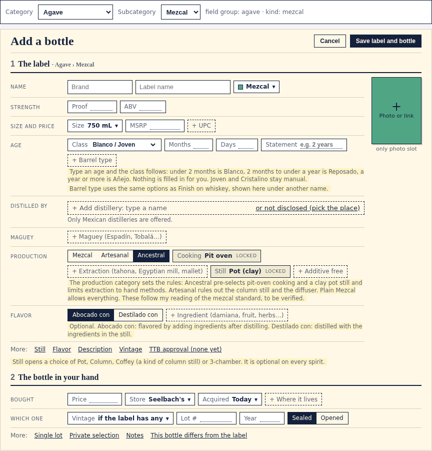 |
| 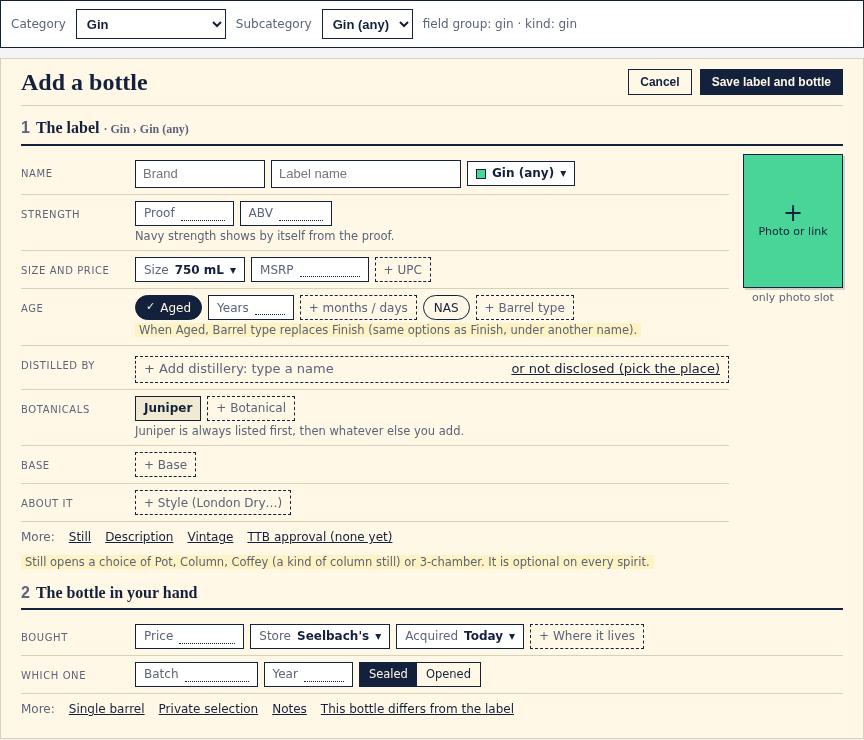 | 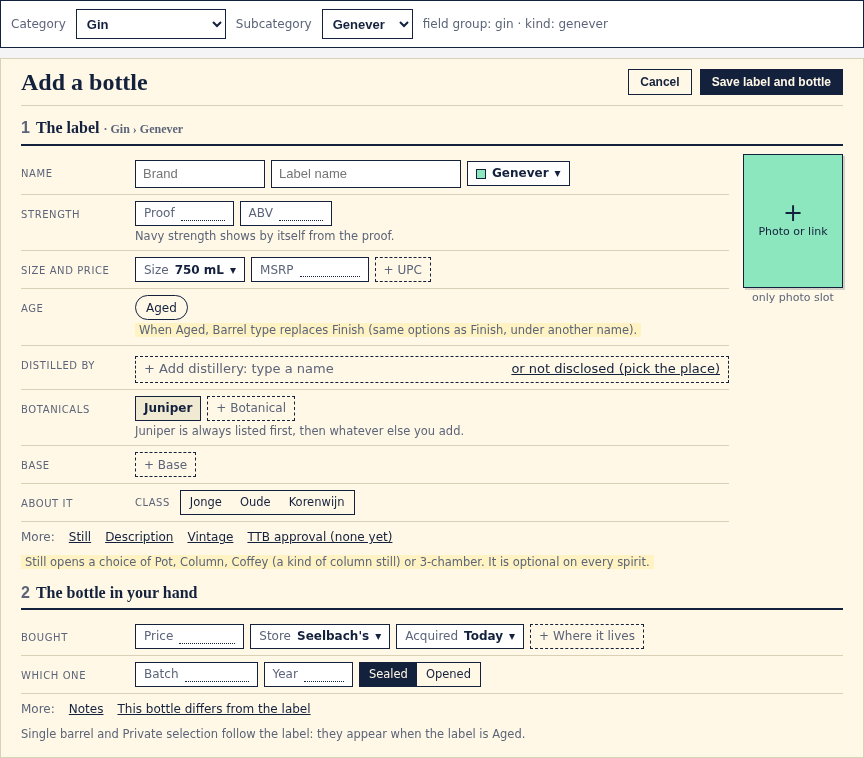 |
| 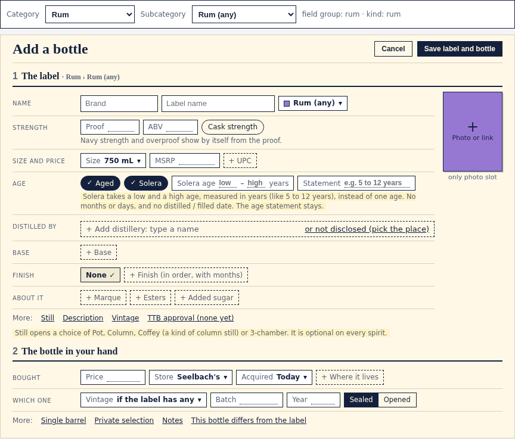 |  |
| 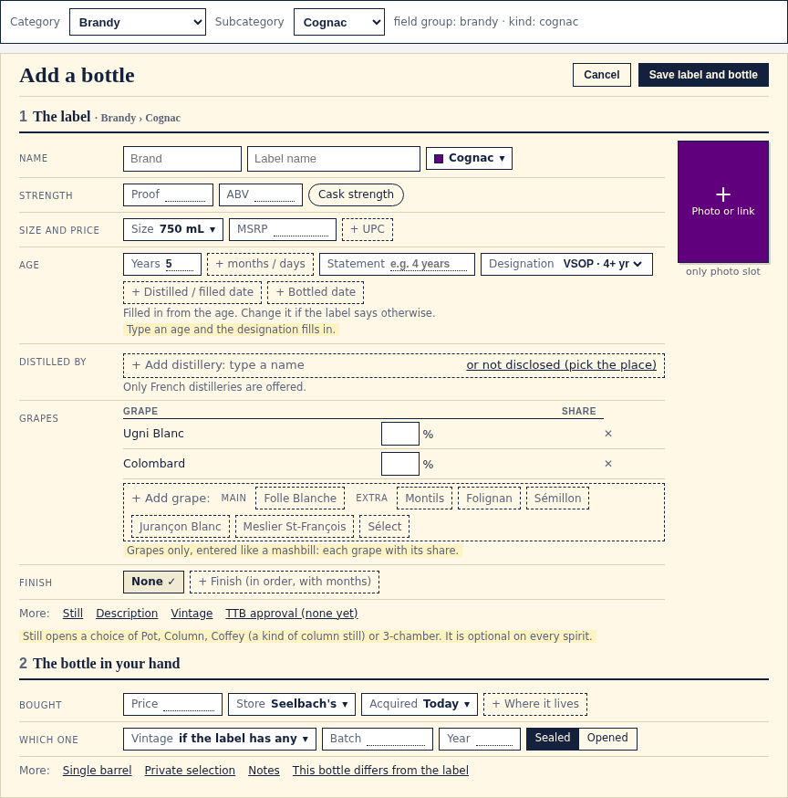 |  |
| 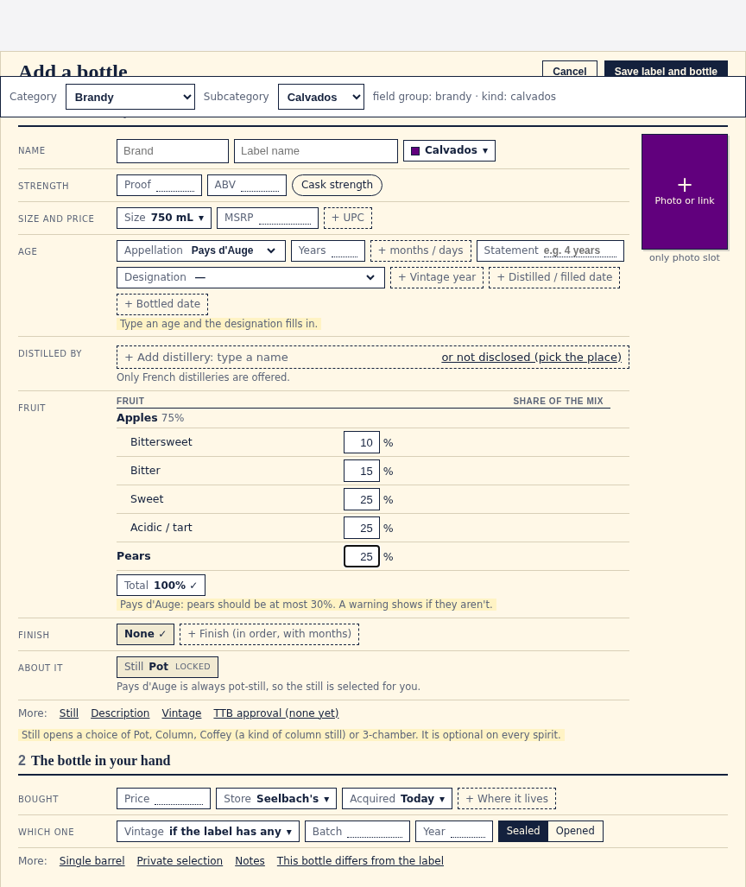 |  |
|  |  |
| 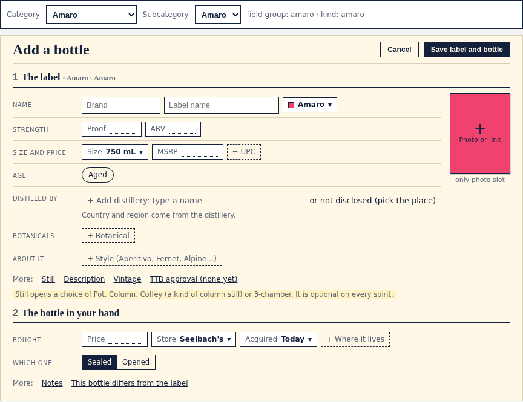 | 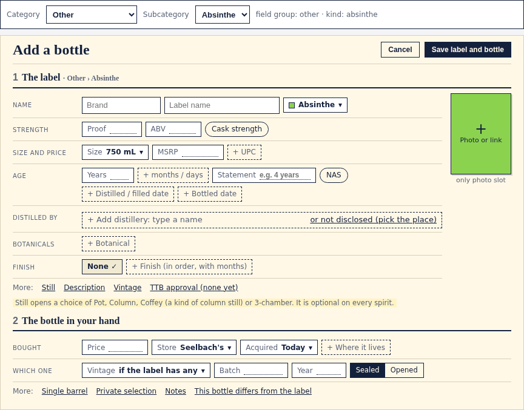 |

The photo screens are in section 11.

## 11. Photos

Scope: getting a photo onto a label or a bottle **from a file or a link**. Removing a background is out of scope. A photo that still has its background loads and is shown as it is; the server keeps deciding once, at upload, whether it is a cutout (see the 2026-10-08 cutout flag spec), and only cutouts get the plate. The mockup is [`photo-flow.html`](2026-11-23-add-bottle-redesign/photo-flow.html).

### 11.1 The slot on the add page

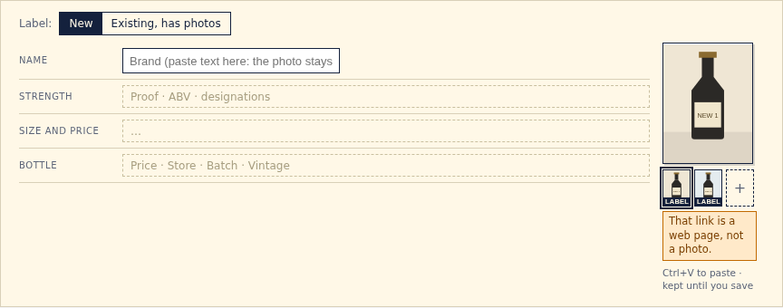

- The orange frame (category colour) says just **"+ Photo"**. Under it: **"Ctrl+V to paste"** (⌘V on a Mac). Users are assumed to know that a drop, a click to pick a file, and a right-click all work.
- **Ways in:** right-click, then *Paste link or image*; press ⌘V / Ctrl+V; drop a file; click to choose a file. A pasted link or a pasted image both work.
- ⌘V is **ignored while a text field has the cursor**, so pasting into Brand or Name never touches the photo.
- Right-click **Paste** reads the clipboard with the async Clipboard API, which needs a secure context (HTTPS) and a permission (Chrome asks once, Safari shows a Paste button each time). Rickhouse is also reachable over plain HTTP on the LAN (`http://<server>:1964`), so ⌘V must always work. The page detects this with **`window.isSecureContext`**, which reports what the browser sees, so it is right behind a reverse proxy or a Cloudflare Tunnel. (The server's own `sentOverHttps()` in `src/lib/auth/request-url.ts` reads `X-Forwarded-Proto` or an https `APP_URL`; this feature does not need it.) On plain HTTP the page says so **up front**: the menu shows a greyed "To paste, press ⌘V", and nothing is offered that then fails.
- The first photo fills the frame. More photos are small thumbnails under it, each tagged **label** or **bottle**, plus a dashed "+" to add another.
- **Right-click a photo:** *Attach to the label* (ticked by default), *Attach to this bottle only*, *Make hero photo*, and *Remove* (for a photo just added). On an existing label's photo, *Hide for this bottle* replaces Remove.

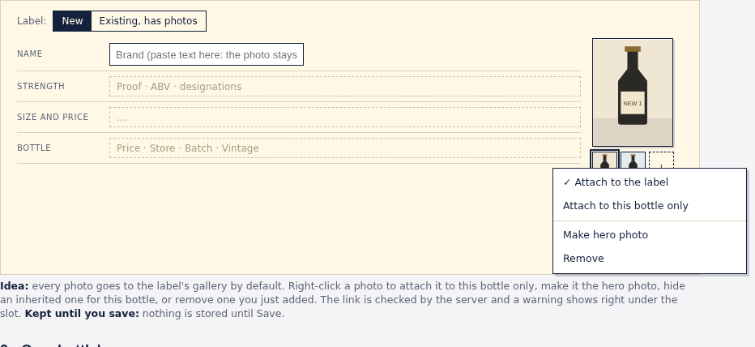

### 11.2 Checking a link, and keeping the download until Save

- When a link is added, the **server checks it** and the page shows a warning right under the slot if it is not a valid photo. Warnings: not a link; could not download the link; the link is a web page, not a photo; the file is not an image.
- The check reuses `src/lib/remote-image.ts`, which already allows only http(s), refuses private addresses (including after redirects), and has a timeout and a size cap.
- The downloaded bytes are **kept (staged) until Save**, and the preview comes from the server, so what you see is what is stored. At Save the staged photo is stored with no second download. A staged photo that is never saved expires. A file chosen from disk can stay in the browser until Save, as it does today.

### 11.3 The model

- A **label has a gallery**: several photos, one of them the **hero photo**. Today a label has a single photo column (`expressions.photo_path`), so this is new data. The existing photo becomes the first gallery photo.
- A **vintage's photos** are a third layer (`expression_releases` already has one photo column). They show on the label's page with a note naming the vintage, and on a bottle's page **only if the bottle is from that vintage**.
- A **bottle shows its label's photos automatically**, by reference with no copies, and can have **its own photos** (the existing bottle photos, including the "catalog" ones, stay on the bottle's page). It can **hide** individual label or vintage photos, per bottle and reversibly.
- **Order on a bottle's page:** its own photos first, then its vintage's, then the label's, and the user can **drag them into any order**. The order is **remembered per bottle**. The **first photo is the bottle's hero photo** (the one on its card), so reordering also chooses the hero photo; *Make hero photo* is a shortcut that moves a photo to the front.
- On the **label's page**: the label's own photos, then each vintage's photos, each with a "Vintage 2023" note.

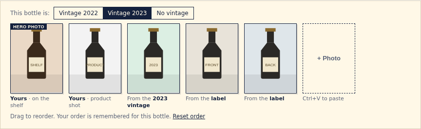

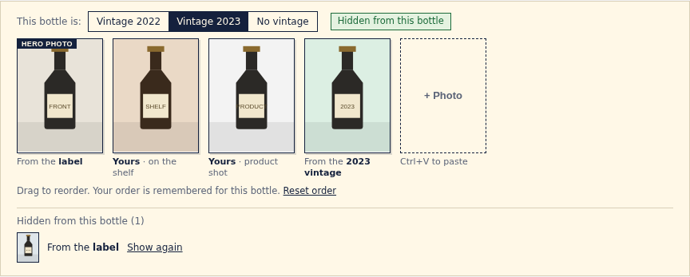

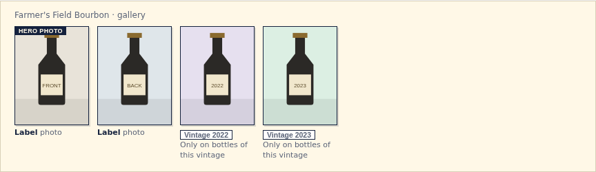

### 11.4 Edge cases decided

- A **new label's first photo is the label's hero photo**. If that photo is attached to the bottle only, the label has no photo yet.
- **Vintage photos are not shown on the add page**, since the bottle's vintage is not known yet.
- A photo added to a label later **appears at the end of every bottle's order**. A deleted label photo disappears from every bottle, along with any "hidden" record for it.
- **Attach to the label instead** (from a bottle's own photo) moves the photo between the bottle's photos and the label's gallery.

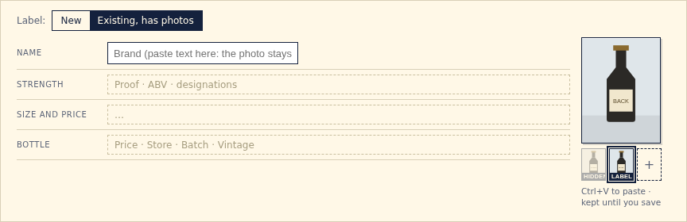

### 11.5 What it needs

- A table of label photos (file, thumbnail, cutout flag, caption, hero flag, order).
- A per-bottle record of hidden label and vintage photos.
- A per-bottle order that mixes the bottle's own photos with inherited ones by reference.
- A staging area for checked links, with a time limit and cleanup, and a "check this link" call. The bottle's hero photo in `bottle_list` follows the bottle's order. The iOS app follows the server as a separate piece of work.
- The bottles and labels pages are redesigned later; the functionality above is what the owner wants to keep.

## 12. Open questions

1. **Retired fields are stored columns** (Still proof, Chill filtered, Colour added, Char level, Bottle count, amaro / liqueur Country and Region). **Decided (2026-11-24): leave the columns dormant now and drop them in a later migration.** Saved values leave the forms in phase 4; the phone API still reads them until it is updated. Still open: the Char Level stave drawing leaves the label and bottle pages with them.
2. How is **Martinique** recorded on a distillery (country "Martinique", or France with a region)? The pre-select needs something to match.
3. **Mezcal:** Production, Class and Flavor are selectors here. Confirm they should not be subcategories. Mezcal keeps the bottle's Vintage choice (only gin and tequila lose it).
4. **To verify later:** the mezcal production rules, the Armagnac minimum ages, and Cristalino's 1-year floor (not used, since nothing is prefilled).
5. **Mosto Verde** is a toggle, not a grape. Confirm.
6. Should **Cognac** also offer Napoléon, Extra and Hors d'Âge?
7. The still enum drops "blend": what happens to existing values?
8. **Colours** for the new subcategories are placeholders.
9. **Not yet reviewed in detail:** Irish, Canadian, Japanese, International and Flavored whisky, Vodka, Absinthe, Akvavit, Shochu, Amaro, Apple brandy, Eau de Vie.
10. Two data-model asks are parked as separate work: **several cooperages** per label (a blend can come from three) and **a per-distillery age** (a blend of 5- and 6-year components).
11. **Photos:** nothing is open in the design. The bottles and labels pages, and the iOS camera flow, are revisited later.
12. **Distillery not disclosed:** restyle the tick-box flow as the small popup (City optional, State, Country; "Will be saved as Undisclosed (Indiana)"), after reading how undisclosed distilleries are stored.
13. **Decided, built (#405): recipe-less mashbills on bourbon and rye labels are allowed.** A secret mashbill or a generic style (High Rye) has no grains to break the 51% rule, so `matchesMashbillCategory` returns true for no grains. A recipe that fails the rule is still kept off the label.
14. **Decided, built (#405): "How Known" is dropped from the web.** The field is gone from the distillery form and "Known As" from its list. The `disclosure` column stays, because the phone sends it (`ios/Rickhouse/DistilleryDraft.swift` through the lookups API), the undisclosed-distillery flow stores it and dashboards and merging read it. The save sets it only when the caller sends it, so editing "Undisclosed (Indiana)" on the web keeps it undisclosed.
15. **Decided, built (#405): the country stays free text with automatic matching.** `normalizeCountry` (`src/lib/places.ts`) folds the usual spellings to one name (us, U.S.A., United States, United States of America, America → USA; mexico, México, MX → Mexico; uk, Great Britain → United Kingdom; about 55 countries in all). An unlisted country is kept as typed, except that one typed in a single case is capitalised by word. Open: existing rows are not rewritten, and a store typed again with the normalised country makes a second store row next to one saved earlier with a different spelling (`createStore` and the `stores_owner_name_place_unique` index compare the country exactly); a data migration would fix it but could collide on that index.

## 13. Not yet designed

Phase 3 (the tree, the kinds and the matrix as data) is built (section 5). Phase 4 is planned in `docs/superpowers/plans/2026-11-24-add-bottle-redesign-phase-4-overview.md`. After the forms: the **Configuration** and **Labels** pages (each has its own GitHub issue, #393 and #394). The popups (add mashbill, distillery and finish) are designed (section 16) and built; the "Distillery not disclosed" popup is the one popup left (open question 12). The photo flow is done as a design (section 11); the bottles and labels pages that show photos are redesigned later, keeping the behaviour in section 11. The iOS photo flow follows the server as separate work. An accordion with a live bottle card (mockup option B) is parked for the **bottle and label display pages**.

## 14. Known problems found in the walkthrough

These are separate from the redesign and could be filed as their own issues. **Status:** fixed in #396 (Description help, ABV %), #397 (two decimals, money pads), #398 (Bottled in Bond restores the proof) and #399 (a pasted TTB ID shows its record on New Label). Still open: the TTB search returning nothing newer than April 2023 (issue #400), the "Vintage" naming clash, vintage prefill, and the hidden whiskey fields.

- MSRP, proof and price accept more than two decimals and do not pad on blur (`$100` stays `$100`). ABV should show a `%`.
- Bottled in Bond overwrites the proof with 100 and does not restore the earlier proof when unticked.
- The Description help text says bottlers and places "live here, not in their own fields", which contradicts the Distilled by field.
- "How Known" in the add-distillery popup is redundant now that "not disclosed" exists.
- "Vintage" names two things: the label's vintages and the bottle section holding batch, release year and single barrel.
- Adding a vintage prefills nothing from the label's proof, age and MSRP.
- TTB: pasting an ID from the real registry does not fill approval date, name, class and permit number (the in-app search does), and the in-app search returned nothing newer than April 2023.
- Chill filtered, Colour added and Char level are defined but hidden for every whiskey, so they never show.

## 15. Where this touches the code

For the plan, not a commitment: `src/lib/expressions/fields.ts` and `rules.ts` (field groups, kinds, hidden fields), `bottle-fields.ts` and `bottle-applicability.ts`, `spirit-details.ts` and `gin-details.ts`, `src/components/expressions/expression-form.tsx`, `bottle-form.tsx` and `label-link-pickers.tsx`, `src/components/catalog/catalog-bottle.tsx` (the search-first page, which would become the default Add bottle), `STILL_TYPES` and the field groups in `src/db/schema.ts`, `scripts/seed.ts` (the category tree), and a migration for categories that move or are retired. For photos (section 11): `src/lib/remote-image.ts` (the link check, reused), the photo routes under `src/app/api/` (`bottles/[id]/images`, `expressions/[id]/photo`), `src/lib/images.ts` (storing and the cutout decision), `PhotoBox` in `expression-form.tsx` and the "Bottle photos" section in `catalog-bottle.tsx` (both replaced by the one slot), the `bottle_list` view that picks a bottle's photo, and `src/db/schema.ts` for the label photos, hidden photos and per-bottle order.

**Relationship to earlier specs.** The October per-spirit specs (spirit-specific, American whiskey, Canadian, Irish, Scotch, vodka, amaro, liqueur label and bottle fields) describe the current form. Where a rule here differs (for example Dairy placement, amaro and liqueur country and region, which whiskey fields apply), this record is the newer direction, and the two should be reconciled when the plan is written. DESIGN.md still describes the visual language.

## 16. Popups

Three popups, opened from a picker's "Add details…" (or "or create a new one"). Mockups: `mashbill-popup.html`, `distillery-popup.html`, `finish-popup.html`. They are clickable, not the app.

**Status (2026-11-24): built** as PRs #402 (shell and finish), #403 (distillery), #404 (mashbill) and #405 (follow-up decisions: recipe-less mashbills, How Known, country spellings). Where the build differs from the mockups, the text below says **As built**. The "Distillery not disclosed" popup is not built (see Add distillery).

**Shared rules**

- A dialog of about 600 to 660px with a serif title, the page dimmed behind it and a sticky footer. It saves to the collection and selects the result in the picker.
- **Every warning is in the footer, left of Cancel, in one amber style.** A message is either blocking (Save is disabled) or says "It will still save".
- Names are tidied (title-cased) when you leave the field. Typeahead suggestions open as a popover; arrow keys and Enter pick one.
- Booleans are toggle chips. Optional fields live under a "More" line. Nothing is shown as "Unknown".
- "Create “name”" (name only) stays in every picker. "Add details…" opens the popup with the name prefilled.
- **As built:** the popups share `PopupShell` (`src/components/admin/popups/popup-shell.tsx`). A problem is `{ text, blocking, notice?, action? }`: `notice` marks a message that is neither a block nor a data warning (a failed save: "Could not reach the server"), so it has no "It will still save." ending and does not disable Save, which lets the same request be retried. Colours are the app's current tokens (`--warning` for the amber), not DESIGN.md's target palette, which the app has not moved to yet.
- **As built:** `titleCase` (`src/lib/admin/popup-problems.ts`) collapses spaces and capitalises each word, including after a hyphen or an opening bracket and for accented letters; it keeps known abbreviations in capitals (PX, NAS, XO, VS, VSOP, USA, IPA, BIB) and leaves a word with an internal capital (McKenna, DeKuyper) as typed.
- **As built:** a dialog opened from inside another (Add company inside Add distillery) is a React child of it, so the shell ignores Enter that bubbles from outside its own DOM. A popup's body is mounted only while it is open, so each opening starts fresh and closing ends a save in flight.

**Add mashbill** (`screenshots/23-mashbill-popup.png`)

- Secret, Generic style and Partial disclosure are toggle chips with one explanatory line. The Name field shows only for Secret and Generic.
- Ingredients are a table (Ingredient, Share) with a colour dot. "+ Add an ingredient" is a plain dashed button that adds a blank row; typing suggests common ingredients.
- Total, bar, legend and "Reads as…" as today. Notes sit under More.
- Footer, blocking: shares over or short of 100%, a missing name or ingredient. Warning only: the category rule (bourbon at least 51% corn, rye at least 51% rye, single malt 100% malted barley).
- **As built:** `mashbillProblems` (`src/lib/mashbills.ts`) mirrors `mashbillSchema`. Blocking: shares over 101 or, unless Partial disclosure is on, under 99 (the text says by how many points); a secret mashbill with no reference name or a generic style with no name; an ingredient with a share and no name, or a name and no share; the same ingredient twice; no ingredient on a public mashbill. A secret mashbill may have no ingredients; a generic style ignores them. Secret and Generic style exclude each other (the server requires it); Partial disclosure is independent.
- **As built:** the category rule is only bourbon and rye (what `matchesMashbillCategory` already did); the single-malt picker is a fixed "100% malted barley" box with no popup. A recipe that fails the rule saves but is kept off the label's list, so the warning reads "It will still save, but it is not added to this label." A mashbill with **no recipe** (a secret one, or a generic style) is allowed onto bourbon and rye labels (open question 13).
- **As built:** the ingredients are the existing `GrainEditor` with an `inPopup` flag that moves its own messages to the footer. Editing an existing mashbill still uses the generic form.

**Add distillery** (`screenshots/24-distillery-popup.png`)

- Fields: Name, Company, then **Place on one line**: City, State, Country, plus one chip that depends on the spirit: DSP (US), NOM (agave and Mexico), Region (Scotch and Scotland). Founded, Defunct, Other old names and Notes are under More. "How Known" is gone from the popup and from the web (open question 14).
- "Create “name”" is offered for all spirits and fills Country from the category (agave Mexico, French brandies France, Canadian whisky Canada, Irish Ireland, Scotch Scotland, bourbon USA). Company is prefilled only when the typed name equals the brand, or "<brand> distillery".
- **Distillery not disclosed** is a small popup (City optional, State, Country). It saves as "Undisclosed (Indiana)" and reuses an existing one.
- Names are unique per owner: a duplicate blocks Save with a "Use it" link. A country that does not fit the spirit is an amber warning, not a block. "KY" becomes "Kentucky" on leaving the field (US only).
- **As built, the identifier follows the country, not the spirit** (`placeIdentifier(country)` in `src/lib/admin/distillery-defaults.ts`), because the save keeps a NOM only for Mexico, a Scotch region only for Scotland and the UK, and a DSP number only for the USA (`distilleriesConfig` in `registry.ts`). The spirit only sets the starting country (`countryForKind`). So an agave label whose distillery is changed to USA shows DSP, not NOM; the mockup showed NOM for any agave label. The country is the normalised one (see open question 15), so "mexico", "México" and "UK" all work, and leaving the Country field turns what was typed into its one name.
- **As built:** one identifier value is kept per kind, so a DSP number typed before changing the country to Mexico is not saved as a NOM. The duplicate check strips the "NOM-1234: " prefix the pickers put in front of a Mexican distillery's name.
- **As built:** name-only create is now offered on every label (a picker with a default country used to hide it) and takes the country from the category through a `country` argument on `quickCreateAction`; the Company is prefilled with `companyPrefill`.
- **As built, not done:** the **Distillery not disclosed** popup is still the existing tick-box flow (`undisclosed-tick.tsx`, its own storage); restyling it is open. "How Known" (`disclosure`) is not hidden from the generic form: the popup omits it and the schema saves an absent value as "named". Editing an existing distillery still uses the generic form.

**Add finish** (`screenshots/25-finish-popup.png`)

- Titled "Add finish", or "Add cask type" for Canadian, Irish and Scotch whisky, amaro and liqueur (as today).
- Name, then **Type as toggle chips** (Wood, Wine, Fortified, Beer, Spirit, Other). The type is **suggested from the name** ("port" or "sherry" suggest Fortified, "oak" Wood, "cognac" Spirit, and so on) and marked "suggested" until you choose. Name-only create uses the same guess, where today it files the finish as Other. Notes are under More.
- Footer, blocking: no name, no type, or a name already in the collection ("Use it"). Names are unique per owner (`finishes_owner_name_unique`, checked in the schema).
- The Finish table behind it keeps the pairing rules from `2026-11-08-whiskey-finish-mashbill-pairing-design.md`: months optional; a Mashbill column with two or more mashbills, **never preselected** (it starts on "Choose…", with no warning); a Share column with two or more finishes or an unfinished portion; one line per mashbill when a finish is on several; running total that must be 100 once any share is entered.
- **As built:** the type guess is `inferFinishType` (`src/lib/admin/finish-type.ts`), whole words only and first match wins (spirit, beer, fortified, wine, wood), so "Port Ellen hogshead" reads as fortified; a name with no known word asks for a type. Name-only create files the finish under the guess instead of Other. "Add cask type" is chosen by the spirit through a `detailNoun` prop. The picker skips an option the label already has, so "Use it" cannot add a finish twice. The finish table behind the popup is unchanged from the pairing spec and was not part of this work.
