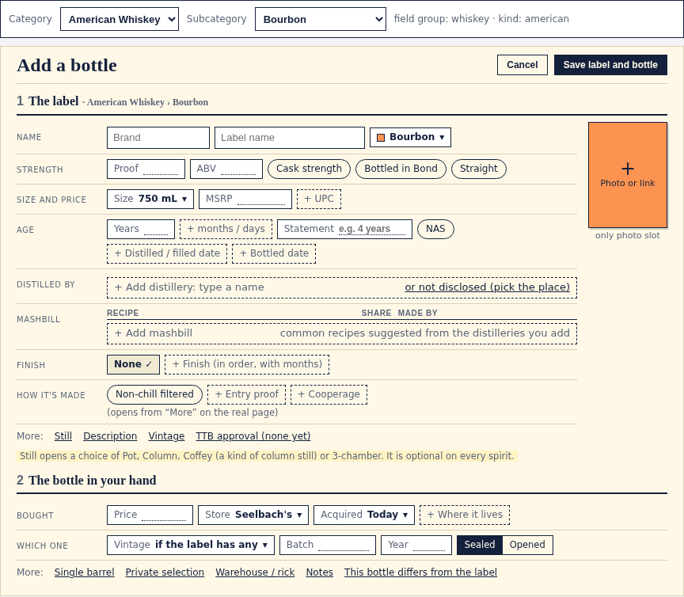
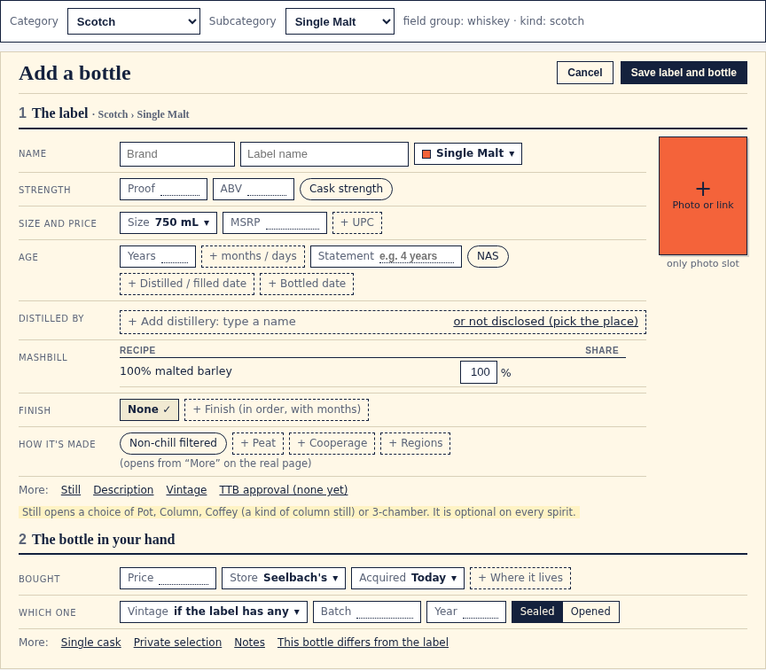
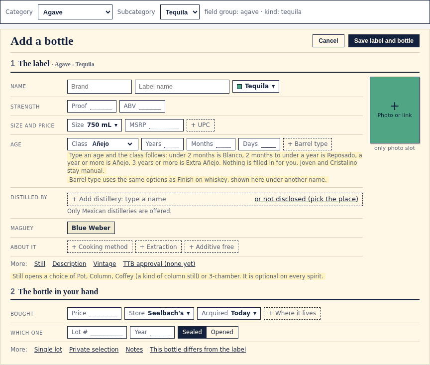
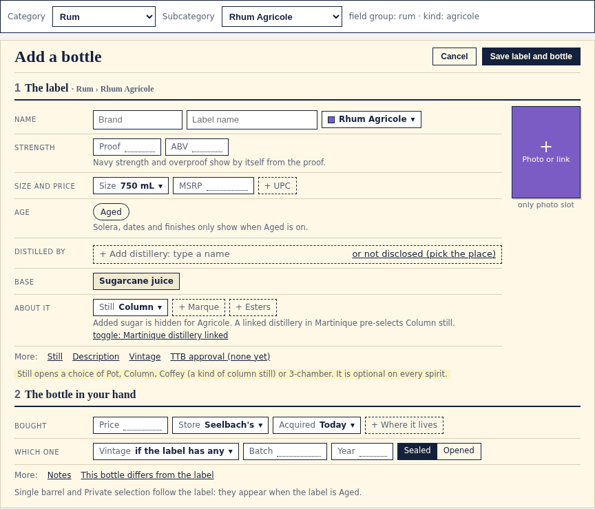
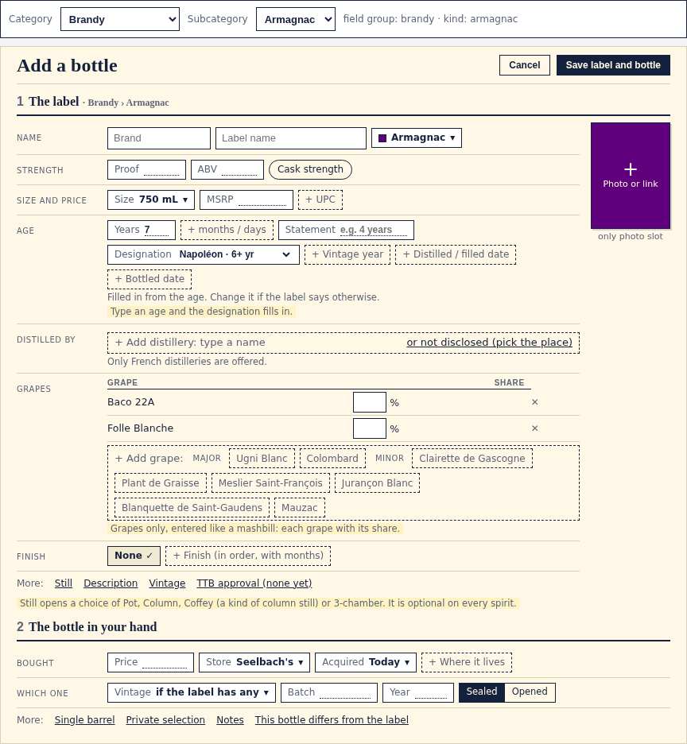
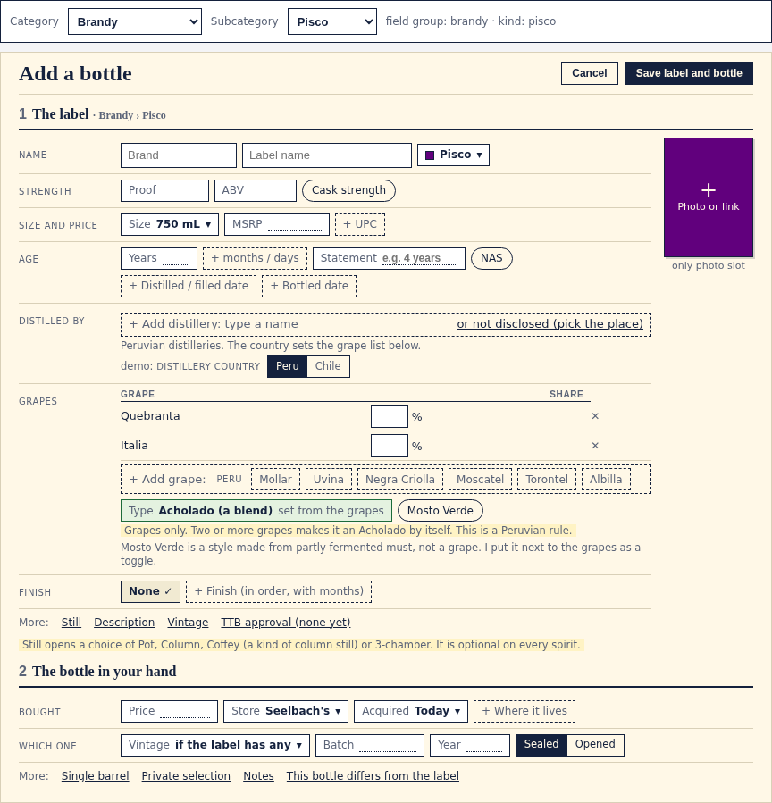
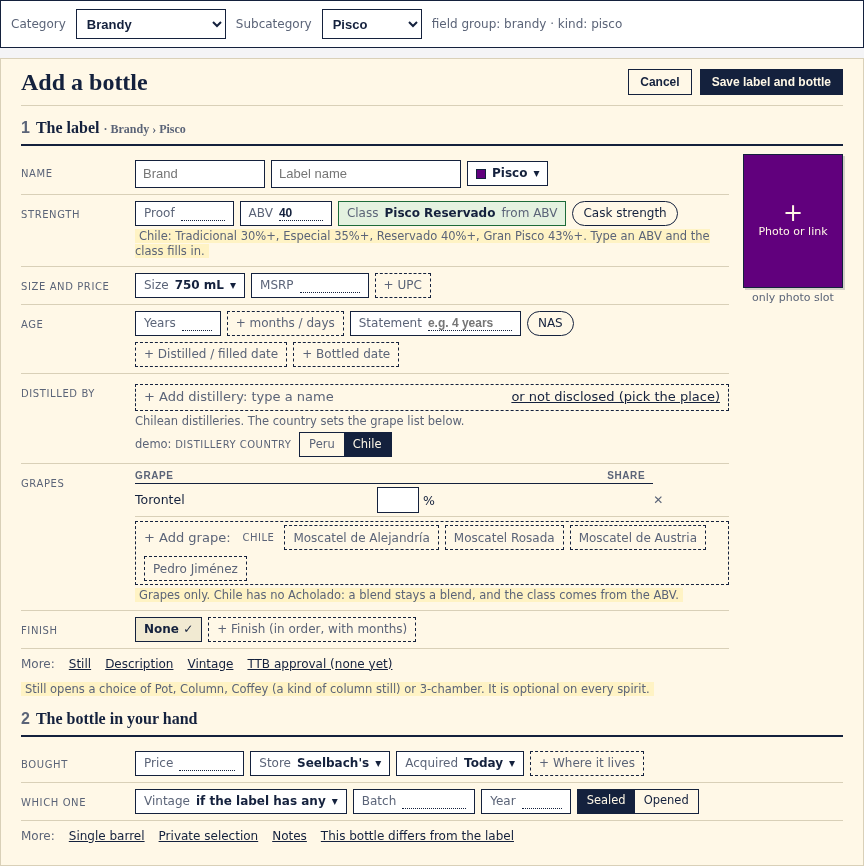
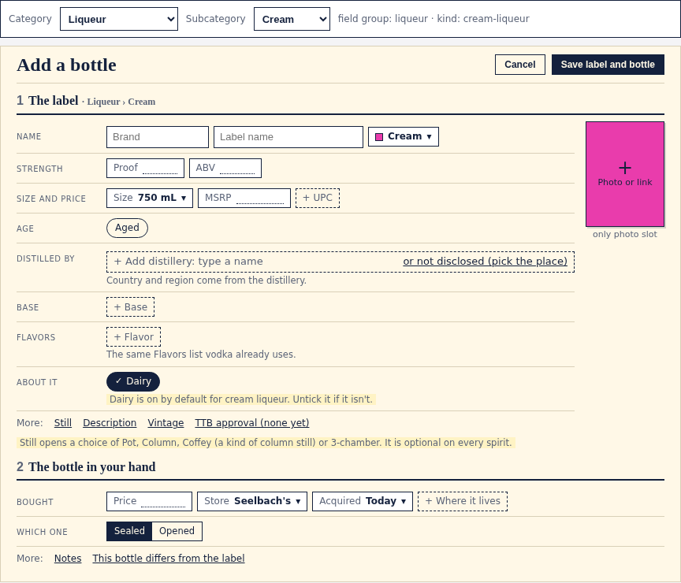

# Add bottle: one page, label then bottle

Status: design record, in progress. Mockups only; nothing is built and the design is not yet approved for a build plan. Written 2026-11-23 from a long design conversation with the owner. Open questions are listed in section 11.

The clickable mockups are in [`2026-11-23-add-bottle-redesign/`](2026-11-23-add-bottle-redesign/). Open `form-by-category.html` in a browser, pick any subcategory, and the form redraws with the fields this record allows. Screenshots are embedded below so they read on GitHub.

## 1. Intent

The Collection page's "Add bottle" button leads to a long form. The owner mostly adds **bottles whose label is not in the app yet**, so the path that creates a label and a bottle in one go is the main one. Today it feels unintuitive for these reasons:

- The form shows the database model (label, vintage, "this bottle's own proof, age and size") instead of the task.
- On a new label, the bottle's override block (about 11 fields) repeats what was typed a moment earlier.
- There are two photo areas (a label photo and "Bottle photos").
- Optional facts are given equal weight with the one required field, and unset selects read "Unknown".
- The TTB approval search is visually loud.
- A first chip-based mockup lost things that matter: stated, inferred and undisclosed distilleries, each distillery's share, separate mashbill and finish.

**The top priority is less scrolling and a form that is easy to fill out.**

## 2. Goals, non-goals, anti-goals

Goals:

- One page: **1 The label**, **2 The bottle in your hand**, one save ("Save label and bottle").
- Each spirit shows only the fields that apply to it (section 7 and 8).
- Nothing the owner can already record is lost: stated / inferred / not disclosed, shares, mashbill and finish as separate things, mashbill and distillery suggesting each other.
- Values that can be worked out are worked out (an age sets the class or designation, and so on).

Non-goals (separate work, see section 12): a wizard or stepper, an accordion (parked for the bottle and label display pages), the popups for adding a distillery, finish or mashbill, the Configuration page, the Labels page, the photo flow.

Anti-goals: hiding data the user has entered, "Unknown" as a default value, a loud TTB call to action, rounded-card soup (see DESIGN.md).

## 3. The layout: "the data sheet"

Chosen over a wizard, an accordion with a live bottle card, and a "printed on the bottle vs what you know" split. See [`screenshots/00-data-sheet-layout.png`](2026-11-23-add-bottle-redesign/screenshots/00-data-sheet-layout.png).

- Rows with a small-caps label on the left. Drawn at **864px wide** (a half-screen on a laptop), which is the width to design for.
- Short facts are chips with an inline input (type straight into Proof, ABV, MSRP, Price). Choices open a popover. Unset optional things are **dashed "+" chips**, never "Unknown".
- Anything with several entries (distilleries, mashbills, grapes, fruit) is a small table with a Share column.
- Rare things live on a **More:** line of links, on the label and on the bottle.
- **Save** is pinned at the top right. A "Save and add another" button was floated but is not decided.
- One photo slot, on the label, framed in the category colour (DESIGN.md section 4). The photo flow itself is still to be designed.

## 4. Decisions that apply to every spirit

Strength and age:

- **Strength row:** Proof, ABV, then the designations that apply (Cask strength, Bottled in Bond, Straight). There is no separate "Flags" group.
- **Age row:** the Aged toggle where it exists, class or designation selects, years / months / days, Age statement, NAS, and dashed "+" boxes for Distilled / filled date and Bottled date. "Age inferred" marks an age that is known but not printed.
- **Size and price row:** Size, MSRP, + UPC.

Where it came from:

- **Distilled by** is a table: Distillery, Share, Source (Stated / Inferred). "Not disclosed (pick the place)" lives inside the add-distillery row, not as a separate checkbox.
- **Mashbill** and **Finish** are separate rows. Mashbills and distilleries suggest each other both ways, and "Made by" ties a recipe to a distillery (this already exists in the form: "Common mashbills" under a distillery and "Common distilleries" under a mashbill). Finish carries months and which mashbill, as it does today (see the 2026-11-08 finish and mashbill pairing spec).
- Grapes (Cognac, Armagnac, Pisco) and Calvados fruit are entered **like a mashbill**: a table of name and share.
- Fixed values show as a plain tinted chip with no "(fixed)" wording (Blue Weber, Sugarcane juice, Juniper, 100% malted barley, Apple).

More lines:

- **Label More:** Still, Description, Vintage, TTB approval. Plus Flavor for mezcal, and Dairy for every liqueur except cream.
- **Bottle More:** Single barrel (the word is "cask" for non-American whiskey and "lot" for agave), Private selection, Warehouse / rick, Notes, "This bottle differs from the label".

TTB approval is **one grey link** under More. It opens a Contractbook-style dialog: search by name or by TTB ID, preview the match, one click fills approval date, name, class and permit number. Pasting an ID from the real registry must fill those the same way (today it does not).

The bottle section:

- **Bought:** Price, Store, Acquired (with a Today button), + Where it lives.
- **Which one:** Vintage choice (only when the label has vintages), Batch (Lot # for agave), Year, Sealed / Opened. Sealed / Opened replaces the status dropdown, the fill dial and the Opened checkbox at add time.
- The bottle's own proof, age and size block is **hidden on a new label** (the bottle inherits). "This bottle differs from the label" opens it.

Still type (new, every spirit): an optional **Still** link under More with the options **Pot, Column, Coffey (a kind of column still), 3-chamber**. The old "blend" value is dropped. Where a rule fixes the still, it stays visible as a locked chip instead (Pays d'Auge is pot, Domfrontais is column, Rhum Agricole with a Martinique distillery pre-selects column).

Barrel type: tequila, mezcal and aged gin show an optional **Barrel type** chip in Age. It is the **Finish data renamed on the page**, with the same options, and the Finish row is hidden for those spirits. Corn Whiskey and Light Whiskey get a Barrel type with the options **Uncharred** and **Used**.

Derived values, never typed twice:

- Age sets the class or designation (tequila, mezcal, Cognac, Armagnac, Calvados). Minimum ages are **floors**: nothing is prefilled, and the age you type drives the class.
- ABV sets the Chilean pisco class. Two or more Peruvian grapes name an Acholado.
- A linked distillery in Martinique on a Rhum Agricole pre-selects Column still.

Retired from every form: **Still proof, Chill filtered, Colour added, Char level, Bottle count**, Country and Region on amaro and liqueur (the distillery supplies it), the VS / VSOP / XO designation on the bottle (the label keeps it), and Barrel-Aged Gin and Aperitif as categories (the Aged toggle and the amaro style cover them).

## 5. Target category tree

The owner confirmed this is a **target** to migrate to, not the current tree. Amaro stays its own field group.

| Top category | Subcategories | Field group |
|---|---|---|
| Agave | Tequila, Mezcal | agave |
| American Whiskey | Bourbon, Rye, American Single Malt, Corn, Wheat, Light, **Tennessee** (new; copies bourbon exactly) | whiskey |
| Irish Whiskey | Pot Still, Malt, Grain, Blended | whiskey |
| Scotch | Single Malt, Single Grain, Blended, Blended Grain, Blended Malt | whiskey |
| Whisky | Canadian, Japanese, Other International, **Flavored** (new; uses vodka's Flavors list) | whiskey |
| Vodka | Flavored Vodka | vodka |
| Gin | Genever | gin |
| Rum | **Cachaça**, **Rhum Agricole**, **Flavored / Spiced Rum** (all new) | rum |
| Brandy | Cognac, Armagnac, Calvados, Pisco, **Apple**, **Eau de Vie** (new) | brandy |
| Liqueur | Fruit, Anise, Cream, Nut, Herbal, Chocolate, Coffee | liqueur |
| Other | **Absinthe**, **Akvavit**, **Shochu** (new) | other |
| Amaro | Amaro (Aperitif is a **style**, not a subcategory) | amaro |

Colours: DESIGN.md has 16 category colours keyed to the old tree. The owner will redo colours later; the mockups use placeholders.

## 6. Which rules need a "kind"

A kind is the rule set the code derives from a category's slug (`rules.ts`). Japanese, Other International and the new subcategories fall into a generic "other" today. They need their own kinds so rules can key on them: `japanese`, `international`, `flavored-whisky`, `cachaca`, `agricole`, `spiced-rum`, `apple`, `eau-de-vie`, `absinthe`, `akvavit`, `shochu`. Peat for American Single Malt, Japanese and International is keyed to the subcategory, not just the group. Calvados appellations and mezcal production and class are **selectors on the form**, not subcategories.

## 7. Field matrix (label)

● always, ◐ under a condition, — not shown. Groups follow the field groups in `schema.ts`.

| Field | Whiskey | Rum | Agave | Brandy | Gin | Vodka | Amaro | Liqueur | Other |
|---|---|---|---|---|---|---|---|---|---|
| Brand, Name, Category, MSRP, Size, UPC, Description | ● | ● | ● | ● | ● | ● | ● | ● | ● |
| Proof, ABV | ● | ● | ● | ● | ● | ● | ● | ● | ● |
| Cask strength | ● | ◐ aged | — | ● | — | — | — | — | ● |
| Bottled in Bond, Straight | ◐ American | — | — | — | — | — | — | — | — |
| Navy / overproof badge (worked out from proof) | — | ● | — | — | ● | — | — | — | — |
| Aged toggle | — | ● | — | — | ● | — | ● | ● | — |
| Age years, months | ● | ◐ aged, not solera | ◐ class fields | ● | ◐ aged | — | ◐ aged | ◐ aged | ● |
| Age days | ● | ◐ | ◐ | ● | ◐ | — | — | — | ● |
| Age statement | ● | ◐ | ◐ mezcal only | ● | — | — | ◐ | ◐ | ● |
| NAS | ● | ◐ | — | ◐ not Cognac, Armagnac, Calvados | ◐ aged | — | ◐ | ◐ | ● |
| Distilled / filled date, Bottled date | ● | ◐ not solera | — | ● | — | — | — | — | ● |
| Solera, low and high age in years | — | ◐ aged | — | — | — | — | — | — | — |
| Barrel type | ◐ Corn, Light | — | ● (not Madurado en Vidrio) | — | ◐ aged | — | — | — | — |
| Non-chill filtered | ● | — | — | — | — | — | — | — | — |
| Additive free | ◐ not American, not Scotch | — | ◐ optional | — | — | — | — | — | — |
| Entry proof | ◐ not Scotch | — | — | — | — | — | — | — | — |
| Peat (optional) | ◐ Irish, Scotch, American Single Malt, Japanese, Intl | — | — | — | — | — | — | — | — |
| Cooperage | ● every whiskey | — | — | — | — | — | — | — | — |
| Regions | ◐ Scotch | — | — | — | — | — | — | — | — |
| Distilleries (share, stated / inferred, not disclosed) | ● | ● | ● | ● | ● | ● | ● | ● | ● |
| Mashbill | ● (single malts fixed) | — | — | — | — | — | — | — | — |
| Ingredients | — | base | maguey | grapes / fruit table | botanicals + base | base | botanicals | base | botanicals or base |
| Flavors list | ◐ Flavored | ◐ Spiced | — | — | — | ◐ Flavored | — | ● | — |
| Finish | ● | ◐ aged | — (Barrel type) | ● | — (Barrel type) | — | ◐ aged | ◐ aged | ● |
| Still (optional, under More) | ● | ● | ● | ● | ● | ● | ● | ● | ● |

## 8. Field matrix (bottle)

| Field | Whiskey | Rum | Agave | Brandy | Gin | Vodka | Amaro | Liqueur | Other |
|---|---|---|---|---|---|---|---|---|---|
| Price, Store, Acquired, Where it lives, Notes, Sealed / Opened, Label version | ● | ● | ● | ● | ● | ● | ● | ● | ● |
| Vintage choice (when the label has any) | ● | ● | ◐ mezcal only | ● | — | — | — | — | ● |
| Batch (Lot # for agave), Release year | ● | ● | ● | ● | ● | — | — | — | ● |
| Single barrel, Private selection | ● | ◐ label aged | ● | ● | ◐ label aged | — | — | — | ● |
| Pick name, Picked by, Barrel number | ● | ◐ | ● | ● | ◐ | — | — | — | ● |
| Warehouse, Rick / floor | ◐ American, Japanese, Intl, Flavored | — | — | — | — | — | — | — | — |
| Size override | ● | ● | ● | ● | ● | ● | ● | ● | ● |
| Proof override | ● | ● | ● | ● | ● | ● | — | — | ● |
| Distilled / filled date, Bottled date | ● | ◐ label aged | — | ● | — | — | — | — | ● |
| Age (years, months, days), Age statement | ● | ◐ label aged | ◐ | ● | ◐ label aged | — | — | — | ● |
| Tequila class, Gin NAS | — | — | ◐ | — | ◐ | — | — | — | — |

Bottle rules for rum and gin **follow the label's Aged toggle**. Bottle count is gone.

## 9. Rules by category

**Tequila.** Class: Blanco, Joven, Reposado, Añejo, Extra Añejo, Cristalino (shown in readable words). Blanco and Reposado take only months and days (legally they cannot be a year old); the others take years too. Typing an age sets the class: under 2 months Blanco, 2 months to under a year Reposado, a year or more Añejo, 3 years or more Extra Añejo. Joven and Cristalino stay manual. Maguey row shows Blue Weber. Barrel type replaces Finish. Optional Cooking method, Extraction, Additive free.

**Mezcal.** Same age-to-class rule without Extra Añejo. Class: Blanco / Joven, Reposado, Añejo, Madurado en Vidrio (no barrel, no age typed). Maguey is a free list. **Production** (Mezcal, Artesanal, Ancestral) sits right after Maguey and restricts cooking, extraction and still: Ancestral pre-selects pit-oven cooking and a clay pot still and limits extraction to hand methods; Artesanal rules out the column still and the diffuser; plain Mezcal allows everything (*these follow the designer's reading of the mezcal standard and must be verified*). **Flavor** (Abocado con, Destilado con, with an ingredient list) is optional and opens from More.

**American whiskey.** Straight and Bottled in Bond apply to all seven subcategories, including Tennessee (which copies bourbon exactly, with the charcoal filtering assumed). Bottled in Bond sets proof to 100 and must restore the typed proof when unticked. American Single Malt gets Peat and a fixed 100% malted barley mashbill. Corn and Light Whiskey get Barrel type (Uncharred, Used).

**Scotch.** Regions, Peat and Cooperage. No Entry proof, no Additive free. Single Malt and **Blended Malt** have the fixed 100% malted barley mashbill.

**Irish, Canadian, Japanese, International, Flavored whisky.** Peat for Irish, Japanese and International. Additive free and Entry proof apply (not to Scotch or American). Canadian restricts distilleries to Canada, Irish to Ireland and the UK. Flavored whisky uses vodka's Flavors list. *These have not been reviewed in detail yet.*

**Gin.** Aged toggle. When Aged: Age years and months (no statement), NAS, Barrel type (replaces Finish), and single-barrel and pick links on the bottle. Botanicals lists **Juniper first**, then what is added, then "+ Botanical". Style (optional, not for Genever).

**Genever.** Class: Jonge, Oude, Korenwijn.

**Rum.** Aged toggle (new). Aged shows years, dates, finishes and cask strength, and the bottle follows. **Solera** (only when Aged) takes a **low and a high age measured in years** (for example 5 to 12 years): no single age, no months or days, no distilled / filled date, and the age statement stays. Still type, Marque, Esters, Added sugar. **Rhum Agricole:** base fixed as sugarcane juice, no Added sugar, and a linked Martinique distillery pre-selects Column still. **Cachaça:** base fixed as sugarcane juice, Added sugar kept. **Spiced:** Flavors list and Added sugar.

**Cognac.** Designation VS (2+ years), VSOP (4+), XO (10+), filled in from the age (and from the statement text). No NAS. Grapes table: main grapes Ugni Blanc, Folle Blanche, Colombard; a secondary grape may be any of those or Montils, Folignan, Sémillon, Jurançon Blanc, Meslier St-François, Sélect.

**Armagnac.** Designation from the age: Blanche (unaged), VS / Three-Star, VSOP, Napoléon, XO, Hors d'Âge, Vintage / Millésimé (with a Vintage year). Minimums used: 1, 4, 6, 10, 10 (*designer's recollection of the official ones; verify*). No NAS. Grapes table: major Ugni Blanc, Baco 22A, Folle Blanche, Colombard; minor Clairette de Gascogne, Plant de Graisse, Meslier Saint-François, Jurançon Blanc, Blanquette de Saint-Gaudens, Mauzac.

**Calvados.** Appellation selector: AOC Calvados, Pays d'Auge, Domfrontais. Fruit is a table with a share for each apple type (Bittersweet, Bitter, Sweet, Acidic / tart) and for Pears, with an Apples subtotal and a Total. Designation from the age: Fine (2+), Vieux / Réserve (3+), VSOP / VO / Vieille Réserve (4+), XO / Napoléon / Hors d'Âge (6+), Millésime (a vintage year). **Pays d'Auge:** pot still locked, pears at most 30%. **Domfrontais:** column still locked, at least 3 years, pears at least 30%. These pear and age rules are **warnings, not blocks**. No NAS.

**Pisco.** Grapes only, entered like a mashbill. **Peru:** Quebranta, Mollar, Uvina, Negra Criolla, Italia, Moscatel, Torontel, Albilla; one grape is a Puro, two or more is an **Acholado** (set automatically, **Peru only**); Mosto Verde is a toggle (a style from partly fermented must, not a grape). **Chile:** Moscatel de Alejandría, Moscatel Rosada, Torontel, Moscatel de Austria, Pedro Jiménez; the class comes from the ABV (Pisco Tradicional 30%+, Especial 35%+, Reservado 40%+, Gran Pisco 43%+); Chile has no Acholado. Peru or Chile follows from the distillery's country.

**Apple brandy.** Fruit fixed as Apple. No French-country rule, no VS / VSOP / XO, no minimum age. NAS kept.

**Eau de Vie.** Fruit list, no grade, NAS kept.

**Liqueur.** Base and Flavors. **Dairy** is under More, never "Dairy: Unknown"; on **Cream** it is ticked by default. Chocolate and Coffee liqueur stay.

**Amaro.** Own field group. Style (including Aperitivo), Botanicals. No distillery country or region fields.

**Absinthe, Akvavit** (botanicals list) and **Shochu** (base list: sweet potato, barley, rice). Group "other".

**Vodka.** No age fields. Base, and Flavors for Flavored Vodka.

## 10. Screens

Generated from `form-by-category.html`. Notes in yellow in the HTML mark decisions.

| | |
|---|---|
|  |  |
|  |  |
|  |  |
|  |  |
|  |  |
|  |  |
|  |  |
|  |  |

## 11. Open questions

1. **Retired fields are stored columns** (Still proof, Chill filtered, Colour added, Char level, Bottle count, amaro / liqueur Country and Region). Drop them, or leave them dormant? Saved values would leave the label and bottle pages, along with the Char Level stave drawing.
2. How is **Martinique** recorded on a distillery (country "Martinique", or France with a region)? The pre-select needs something to match.
3. **Mezcal:** Production, Class and Flavor are selectors here. Confirm they should not be subcategories. Mezcal keeps the bottle's Vintage choice (only gin and tequila lose it).
4. **To verify later:** the mezcal production rules, the Armagnac minimum ages, and Cristalino's 1-year floor (not used, since nothing is prefilled).
5. **Mosto Verde** is a toggle, not a grape. Confirm.
6. Should **Cognac** also offer Napoléon, Extra and Hors d'Âge?
7. The still enum drops "blend": what happens to existing values?
8. **Colours** for the new subcategories are placeholders.
9. **Not yet reviewed in detail:** Irish, Canadian, Japanese, International and Flavored whisky, Vodka, Absinthe, Akvavit, Shochu, Amaro, Apple brandy, Eau de Vie.
10. Two data-model asks are parked as separate work: **several cooperages** per label (a blend can come from three) and **a per-distillery age** (a blend of 5- and 6-year components).

## 12. Not yet designed

Next, in order: the **photo flow** from this page, then the **popups** (add distillery, add finish, add mashbill and the rest) in this style ("How Known" goes, since "not disclosed" replaced it), then the **Configuration** and **Labels** pages. An accordion with a live bottle card (mockup option B) is parked for the **bottle and label display pages**.

## 13. Known problems found in the walkthrough

These are separate from the redesign and could be filed as their own issues:

- MSRP, proof and price accept more than two decimals and do not pad on blur (`$100` stays `$100`). ABV should show a `%`.
- Bottled in Bond overwrites the proof with 100 and does not restore the earlier proof when unticked.
- The Description help text says bottlers and places "live here, not in their own fields", which contradicts the Distilled by field.
- "How Known" in the add-distillery popup is redundant now that "not disclosed" exists.
- "Vintage" names two things: the label's vintages and the bottle section holding batch, release year and single barrel.
- Adding a vintage prefills nothing from the label's proof, age and MSRP.
- TTB: pasting an ID from the real registry does not fill approval date, name, class and permit number (the in-app search does), and the in-app search returned nothing newer than April 2023.
- Chill filtered, Colour added and Char level are defined but hidden for every whiskey, so they never show.

## 14. Where this touches the code

For the plan, not a commitment: `src/lib/expressions/fields.ts` and `rules.ts` (field groups, kinds, hidden fields), `bottle-fields.ts` and `bottle-applicability.ts`, `spirit-details.ts` and `gin-details.ts`, `src/components/expressions/expression-form.tsx`, `bottle-form.tsx` and `label-link-pickers.tsx`, `src/components/catalog/catalog-bottle.tsx` (the search-first page, which would become the default Add bottle), `STILL_TYPES` and the field groups in `src/db/schema.ts`, `scripts/seed.ts` (the category tree), and a migration for categories that move or are retired.

**Relationship to earlier specs.** The October per-spirit specs (spirit-specific, American whiskey, Canadian, Irish, Scotch, vodka, amaro, liqueur label and bottle fields) describe the current form. Where a rule here differs (for example Dairy placement, amaro and liqueur country and region, which whiskey fields apply), this record is the newer direction, and the two should be reconciled when the plan is written. DESIGN.md still describes the visual language.
